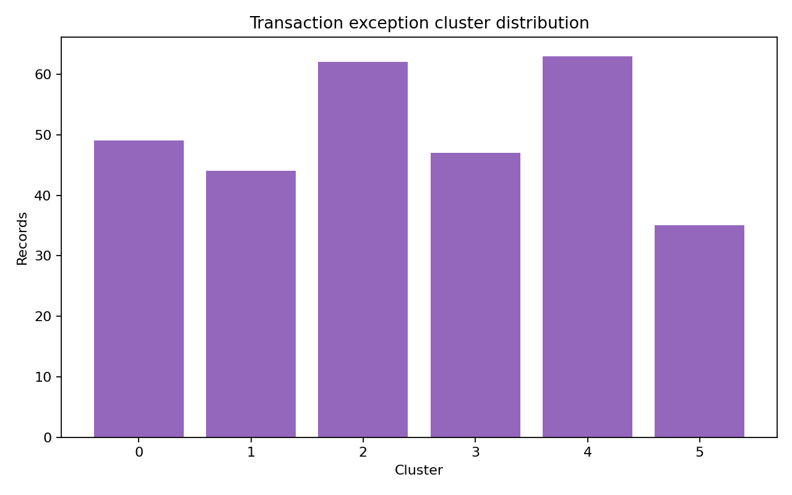
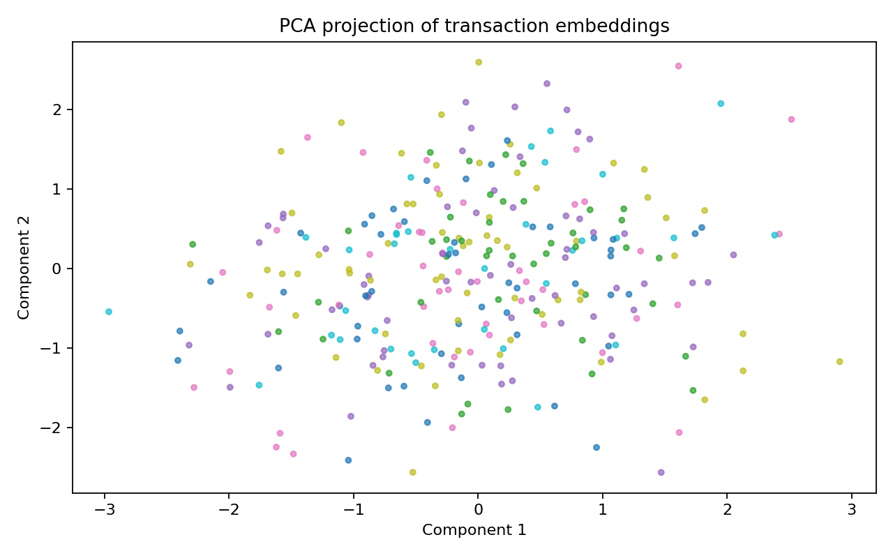

# Transaction Log Miner

## Objective

Payment-operation failures are often buried in free-text complaints and incident logs. This project converts narratives into semantic representations and clusters recurring exception patterns, creating an analytical view of root causes, ISO 20022 remediation opportunities and customer impact.

## Architecture

```text
Transaction-Log-Miner/
├── assets/
│   └── charts/                         # Cluster and embedding diagnostics
├── data/
│   └── CFPB_complaints_2026_02_15.csv
├── notebooks/
│   └── Transaction_log_mining.ipynb
├── src/
│   ├── log_preprocessor.py             # Narrative preparation
│   ├── embeddings.py                   # Semantic representation
│   ├── clustering.py                   # K-Means and projection
│   └── generate_charts.py              # Cluster diagnostics
└── tests/
```

## Quickstart

```bash
pip install -r requirements.txt
python -m src.generate_charts
```



Cluster volume shows whether operational incidents are concentrated in a small set of recurring failure modes. It supports prioritisation and provides a governance checkpoint before cluster labels are used to drive automated triage or remediation investment.



The embedding projection is an explainability diagnostic for the clustering decision. Separation supports confidence in the taxonomy; overlap signals that the representation, labels or downstream automation should be challenged before operational use.
